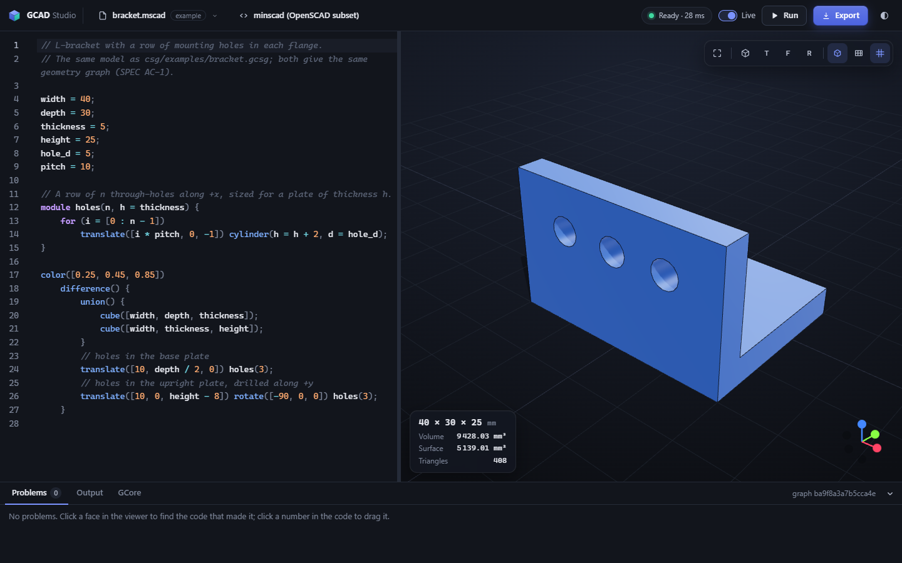
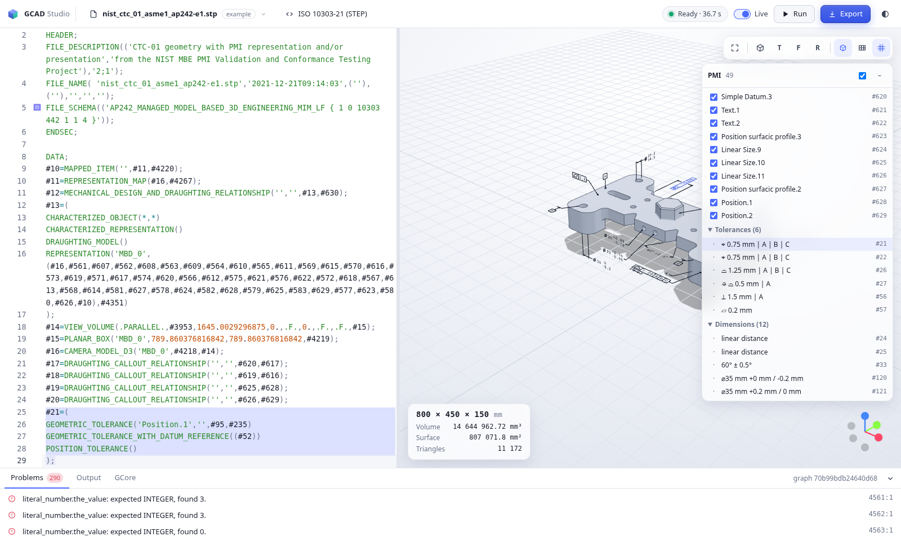

# GCAD Studio

A language-agnostic, code-first CAD studio: what Jupyter did for IPython, GCAD Studio aims to do for OpenSCAD. A **kernel** is a modelling language defined by a formal grammar and rewrite rules; the studio parses it into one shared functional core language (GCore), evaluates it to a neutral geometry graph, renders it, and exports it to neutral and vendor formats. The idea comes from [openscad/openscad#2299](https://github.com/openscad/openscad/issues/2299); the full requirements are in [docs/SPEC.md](docs/SPEC.md).



## The studio

```bash
gcad serve                 # opens the studio in your browser; files live in the current folder
gcad serve part.mscad      # ... and opens a file
```

- **Code on the left, the model on the right**, re-rendered as you type (Live) or on `F5`. Errors are underlined in the code and listed below; the last good model stays on screen.
- **Click a number** in the code and drag the slider: the model follows.
- **Click a face** of the model: the code that made it is selected.
- **`Ctrl+O`** opens examples and files, **`Ctrl+S`** saves, **`Ctrl+E`** exports to any format below, one click each.
- Dark and light themes, highlighting derived from each language's own grammar, a GCore tab showing what your code was rewritten into.

It runs on your machine only: the server listens on 127.0.0.1, every call needs the session token in the address it prints, and nothing is loaded from the internet. Geometry is computed in Python; the browser draws it with WebGL, which works with any GPU or with the browser's software renderer.

A model that runs away stops with a message instead of hanging: at 10 s of evaluation, a call depth of 1,000, 10⁶ loop iterations or 10⁵ geometry nodes. In Live mode the next edit stops an evaluation still running, so the studio never queues up behind one.

### In the browser, nothing installed

The same studio also runs as a static web site, live at **[gcadstudio.github.io/studio](https://gcadstudio.github.io/studio/)** ([SPEC §4.1](docs/SPEC.md#41-web-deployment-mode-m7)): Python runs inside the page through [Pyodide](https://pyodide.org) in a Web Worker, and the mesh back-end is Manifold's own WebAssembly build. Your files stay in the browser (with Upload and Download in `Ctrl+O`), and nothing is sent anywhere. STEP files with explicit B-rep open there too, read by OpenCASCADE's WebAssembly build (occt-import-js, loaded only when a STEP file is opened). Writing STEP and IGES needs OpenCASCADE's modelling back-end, so those two exports need the local install; the other twelve formats work. Build the site and serve it with any static file server:

```bash
python tools/build_site.py --out site    # fetches the pinned, checksummed Pyodide and Manifold once
python -m http.server -d site 8000       # then open http://127.0.0.1:8000
```

## Status

Pre-alpha, version 0.2.0a2, a pre-release: milestones M0 to M8, M14 and M15 of [the plan](docs/SPEC.md#12-delivery-plan) are done; M9 to M13 are next. What changed is in [CHANGELOG.md](CHANGELOG.md).

| Works now |
|---|
| The studio: `gcad serve`, editor, 3D and 2D viewer, export dialog |
| GCore language and evaluator with source spans, limits and diagnostics |
| Grammar kernels: a Lark EBNF grammar + GCore rewrite templates, no Python |
| Kernels `minscad` (`.mscad`, OpenSCAD subset), `csg` (`.gcsg`, S-expressions), `parts` (`.parts`, a parts list) |
| Kernel `elmergrid` (`.grd`): ElmerGrid's structured-mesh format from [Elmer FEM](https://www.elmerfem.org), MATC expressions included, one solid or region per material; written only as grammar, rewrite rules and a GCore prelude, and checked against ElmerGrid on 441 of the 531 distinct `.grd` files in Elmer's sources |
| Kernel `blockmesh` (OpenFOAM's `system/blockMeshDict`): the solid of a CFD block mesh, one coloured part per zone, in mm |
| Process kernels: any language with a program of its own; bundled `openscad` (`.scad`, your installed OpenSCAD) and `cadquery` (`.cq.py`, CadQuery in its own environment) |
| Exact B-rep back-end on [OpenCASCADE](https://dev.opencascade.org); mesh back-end on [Manifold](https://github.com/elalish/manifold); both CPU only |
| 3D export: STEP (AP214/AP242), IGES; STL, OBJ + MTL, glTF, X3D, VRML, COLLADA, UNV |
| 2D models and sections of 3D models; 2D export: DXF, SVG, PDF, EPS, CGM |
| `gcad` command line, headless |
| The web studio: the same UI and Python core in the browser (Pyodide), a static site for GitHub Pages; no STEP or IGES there |
| Kernel `iso10303` (`.stp`, `.step`, `.p21`, M14): STEP files with ISO 10303-42 CSG, -55 histories, -108 parameters, -111 holes and pockets, -112 sketches; explicit B-rep through OpenCASCADE; checked against the AP242 long form with every rule evaluated. Export `step-parametric` writes models back as parametric STEP. [Coverage, entity by entity](docs/design/iso10303-coverage.tsv) |
| PMI in STEP AP242 (M15): graphical PMI drawn, semantic PMI (tolerances, dimensions, datums) listed with the faces it applies to, saved views; in the studio and the browser |

Run `gcad formats` to see every format and which back-ends are available.

### STEP, parametric

Open a STEP file like any source: CSG, a Part 55 history or explicit B-rep becomes the model, and a slider on an ISO 10303-108 parameter's value drives it. Write any model back as parametric STEP, with its numeric definitions as parameters:

```bash
gcad iso schema fetch AP242                       # once: the AP242 long form ISO publishes, for checking
gcad eval part.stp                                # the model, and every AP242 rule evaluated
gcad export part.mscad -f step-parametric -o part.stp
gcad iso check part.stp                           # header, schema and rules, with counts
```

The design, the grammar's trace to the standard and what is verified how are in [docs/design/iso10303-kernel.md](docs/design/iso10303-kernel.md).

### PMI, GD&T and MBD

A STEP AP242 file's annotations open with it (M15): the callouts are drawn on the model, and the panel beside the viewer lists the saved views, the geometric tolerances, dimensions and datums. Each row has a check box for its drawing, opens its `#n` line in the editor and lights up the faces it applies to; clicking a face of the part marks the rows that apply to it. The same works in the browser, where OpenCASCADE's WebAssembly build reads the part: try it [on the web studio](https://gcadstudio.github.io/studio/#open=example:iso10303/examples/nist_ctc_01_asme1_ap242-e1.stp). Two of NIST's PMI test files are bundled as examples (`Ctrl+O`, type `nist`). `gcad eval part.stp --dump annotations` lists the same in a terminal.



## Install

Python 3.11 or newer on Windows, macOS or Linux, x86_64 or arm64. No compiler or GPU is needed. OpenCASCADE comes as the `cadquery-ocp` wheel, which does not exist for Windows on ARM; there the studio runs without STEP and IGES and says so.

From a release, with the wheel from [GitHub Releases](https://github.com/GCADstudio/studio/releases):

```bash
pip install gcad_studio-0.2.0a2-py3-none-any.whl
```

From a clone, for development:

```bash
pip install -e ".[dev]"
```

## Five-minute tour

The same part in three languages. In `minscad`, an OpenSCAD subset, `part.mscad`:

```openscad
// 40 x 30 x 10 mm block with an 8 mm through-hole
module hole(d) translate([20, 15, -1]) cylinder(h = 12, d = d);

color("silver")
    difference() {
        cube([40, 30, 10]);
        hole(8);
    }
```

In `parts`, a declarative parts list, `part.parts`:

```
part block: box 40 30 10 color silver
cut  hole:  cylinder d 8 h 12 at 20 15 -1
```

In `csg`, S-expressions that are GCore itself, `part.gcsg`:

```scheme
; 40 x 30 x 10 mm block with an 8 mm through-hole
(define (hole d) (translate [20 15 -1] (cylinder :h 12 :d d)))

(color "silver"
  (difference
    (box [40 30 10])
    (hole 8)))
```

```bash
gcad eval part.mscad                    # check it: diagnostics and a graph summary
gcad eval part.mscad --dump gcore       # what the kernel rewrote it into
gcad eval part.mscad --dump graph       # the language-neutral geometry graph as JSON
gcad export part.mscad -o part.step     # exact B-rep; also .igs; --schema AP242
gcad export part.mscad -o part.stl      # meshes: .stl .obj .glb .x3d .wrl .dae .unv
gcad export part.mscad -o part.glb --tol 0.01  # finer tessellation (mm)
gcad formats                            # every format, and which back-ends are available
gcad kernels                            # languages on the kernel search path
```

`part.mscad` and `part.gcsg` evaluate to the same geometry graph (`gcad eval --dump hash` prints the same hash). Every `minscad` example is a valid OpenSCAD file, and the test suite checks that OpenSCAD builds the same solid from it.

GCore at a glance: `(define name expr)`, `(define (f x (y 2)) body)`, `(module (name params) body)` where shape arguments arrive as `children`, `(fn (x) body)`, `(let ((a 1) (b (* a 2))) body)`, `(if c a b)`, `(for ((i (range 0 4))) body)` (inclusive, like OpenSCAD), named arguments as `:name value`, vectors as `[x y z]`, angles in degrees. Geometry: `box sphere cylinder polyhedron rect circle polygon translate rotate scale mirror matrix union difference intersection linear_extrude rotate_extrude color name`. Tessellation follows `$fn/$fa/$fs` when given, otherwise a tolerance of 0.1 % of the model's size. See the examples in [src/gcad/kernels/csg/examples](src/gcad/kernels/csg/examples).

Conventions follow OpenSCAD and were checked against OpenSCAD 2021.01 output: rotation order X→Y→Z, `rotate(a, v)`, `mirror`, clockwise faces in `polyhedron`, the profile plane of `rotate_extrude`, the direction of `linear_extrude` twist, and positional argument orders such as `cylinder(h, r1, r2, center)`. Twisted extrusions are triangulated along the other diagonal from OpenSCAD: both approximate the exact volume from opposite sides, and the difference shrinks as `slices` grows.

What `minscad` covers and what it does not yet is listed in [SPEC §5.2](docs/SPEC.md#52-kernels-a-language-defined-by-a-formal-grammar).

## Add a language

A kernel is a folder: `kernel.toml`, a Lark grammar `grammar.lark`, and `rewrite.toml`, which turns each grammar rule into GCore. No Python. The [kernel authoring guide](docs/kernel-authoring.md) builds one from scratch. Drop the folder into `./kernels`, your user kernel folder, or a folder on `GCAD_KERNEL_PATH`, then:

```bash
gcad kernel check path/to/kernel        # grammar, rewrite coverage, examples
gcad kernel describe path/to/kernel     # keywords and token classes for an editor
```

A language that already has a program of its own becomes a **process kernel**: the manifest says `parser = "process"` and names the program under `[process] command`. The program answers a small JSON-RPC protocol on stdin/stdout and hands back a geometry graph, a STEP file or a mesh ([SPEC §7.2](docs/SPEC.md#72-server--process-kernel-s)). Such a kernel runs a program with your rights, so one from outside GCAD Studio runs only after you trust its folder:

```bash
gcad kernel trust path/to/kernel        # the studio asks the same question on first use
```

Two process kernels come bundled. **`openscad`** opens `.scad` files with the OpenSCAD you have installed, on PATH, in its usual folder, or named by `OPENSCAD`, and shows the mesh OpenSCAD makes; STEP and IGES are not offered for it, because that mesh is not exact geometry. **`cadquery`** runs `.cq.py` scripts that call `show_object(...)` or set `result`. CadQuery pins an older OpenCASCADE binding than GCAD Studio, so it lives in an environment of its own:

```bash
uv venv cq && uv pip install --python cq cadquery
export GCAD_CADQUERY_PYTHON=$PWD/cq/bin/python   # Windows: cq\Scripts\python.exe
gcad export src/gcad/kernels/cadquery/examples/test_part.cq.py -o part.step
```

## Exports and units

STEP and IGES come from the exact OpenCASCADE back-end: cylinders, cones, spheres and revolutions are true analytic surfaces, so a STEP part is a B-rep solid, not a mesh (checked by re-reading with OpenCASCADE and parsing with the independent `steputils`; other CAD systems have not been tried yet). Mesh formats come from Manifold unless you pass `--backend occt`. A cylinder with an explicit `$fn` of 3 to 16 stays the polygon OpenSCAD would make, so hex nuts stay hexagonal in STEP too.

Documents are in millimetres, and each format is written by its own convention:

| Format | Units and axes |
|---|---|
| STEP, IGES, COLLADA, UNV | millimetres declared in the file; +Z up |
| X3D | millimetres declared by the X3D 3.3 UNIT statement; turned so +Z points along X3D's +Y up |
| glTF, VRML | metres and +Y up by definition: vertex data stays in mm, one root transform scales by 0.001 and turns the model |
| STL, OBJ | no unit field: millimetres (OBJ says so in a comment) |

**2D.** A 2D model (`square`, `circle`, `polygon` and their booleans) exports directly; a 3D model needs a cut first: `projection(cut = true)` in minscad, `(section ...)` or `(project ...)` in GCore. DXF, SVG, PDF, EPS and CGM are written at 1:1 in millimetres, as closed outlines drawn with a 0.1 mm hairline (what laser cutters and plotters expect), on a page of the drawing's extents plus a 1 mm margin:

```bash
gcad export src/gcad/kernels/minscad/examples/plate2d.mscad -o plate.dxf   # also .svg .pdf .eps .cgm
gcad export src/gcad/kernels/minscad/examples/section.mscad -o section.svg
```

Exports are reproducible: the same source gives byte-identical files (the tests export every format in two separate processes and compare the bytes). STEP, IGES, COLLADA, DXF, PDF and EPS contain a date; set `SOURCE_DATE_EPOCH` or `--epoch` to fix it. STEP and IGES headers never contain your user name or organisation.

## Development

```bash
pytest -q
ruff check . && ruff format --check . && mypy
```

CI runs the tests and a headless export on Linux, Windows and macOS, each on x86_64 and arm64; drives the studio in headless Chrome with software WebGL (no GPU) and keeps its screenshots; and checks CGM and DXF with LibreOffice. The UI test runs locally too when Playwright and Chrome or Edge are installed (`pip install playwright`). A separate job builds the web studio and checks it in headless Chrome (`tests/test_web.py`, which builds the site itself unless `GCAD_SITE` points to one); on `master` that job's site is published to GitHub Pages.

The front end's JavaScript (three.js, CodeMirror) is vendored in `src/gcad/web/vendor` so the studio works offline; `tools/vendor-web` rebuilds it (`npm ci && npm run build`).

## Licence

AGPL-3.0, see [LICENSE](LICENSE).

The examples `nist_ctc_01_asme1_ap242-e1.stp` and `nist_ctc_05_asme1_ap242-e1.stp` are test files of the [NIST MBE PMI Validation and Conformance Testing](https://www.nist.gov/ctl/smart-connected-systems-division/smart-connected-manufacturing-systems-group/mbe-pmi-0) project, by the National Institute of Standards and Technology, which may be used without restrictions; they are unchanged.
